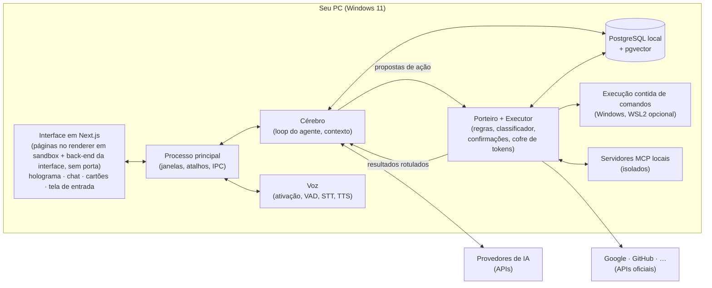

# Parte 2 — Arquitetura (inspirada no Claude Code)

> [Índice da documentação](README.md) · Parte 2 de 10 · as seções seguem a numeração 2.x

## 2.1 Mapa: Claude Code → Jesus

| Conceito | Como funciona no Claude Code | Como fica no Jesus |
|---|---|---|
| **Loop agêntico** | Coletar contexto → agir → verificar, repetindo até concluir; o usuário pode interromper a qualquer momento | Igual. Implementado com o `ToolLoopAgent` do AI SDK ou um loop próprio ([Parte 4](04-tecnologias.md)) |
| **Ferramentas internas** | `Read`, `Write`, `Edit`, `Glob`, `Grep`, `Bash`/`PowerShell`, `WebFetch`, `WebSearch`, `Agent` (subagente), `AskUserQuestion`, ferramentas de tarefas, `Monitor`, `LSP`… ([Tools reference](https://code.claude.com/docs/en/tools-reference)) | Conjunto equivalente + ferramentas pessoais (agenda, e-mail, GitHub, memória). Catálogo na seção 2.5 |
| **Regras de permissão** | Avaliadas na ordem `deny → ask → allow`; a primeira que casar decide; um `allow` nunca abre exceção num `deny`; uma negação em qualquer nível de configuração vence ([Permissions](https://code.claude.com/docs/en/permissions)) | Camada 1 do Porteiro, com a mesma precedência |
| **Caminhos protegidos e críticos** | Escrita em `.git`, `.vscode`, `.idea`, `.husky`, `.devcontainer`, `.claude` etc. nunca é automática; `rm` na raiz do disco, na home, em `C:\Windows` ou na pasta de trabalho nunca é aprovado por regra ([Permission modes](https://code.claude.com/docs/en/permission-modes)) | Igual, com listas adaptadas ao Windows e ao Jesus (seção [3.4.3](03-seguranca.md)) |
| **Modos de permissão** | Manual, aceitar edições, planejar, automático, `dontAsk`, `bypassPermissions` (este só em contêiner ou VM) | Somente leitura, Perguntar, Planejar, Automático com Porteiro. **Sem modo "pular tudo"** fora da sandbox |
| **Modo automático** | Sonda de injeção nos resultados + classificador que revisa cada ação **sem ver** o raciocínio do agente nem os resultados das ferramentas ([Anthropic Engineering](https://www.anthropic.com/engineering/claude-code-auto-mode)) | Camadas 2 a 4 do Porteiro (seção [3.4](03-seguranca.md)) |
| **Sandbox** | Isolamento de arquivos e rede (Seatbelt no macOS, bubblewrap no Linux/WSL2); **não roda no Windows nativo** ([Sandboxing](https://code.claude.com/docs/en/sandboxing)) | Por padrão, como o Claude Code no Windows: comandos rodam direto no Windows, com contenção (ambiente sem segredos, token restrito, Job Object). WSL2 como opção avançada (seção [3.6](03-seguranca.md)) |
| **Hooks** | Eventos como `PreToolUse`, `PostToolUse`, `UserPromptSubmit`, `Stop`, `SessionStart`, `PreCompact`; um hook pode bloquear, mas não derruba uma regra `deny` ([Hooks](https://code.claude.com/docs/en/hooks)) | Ganchos em TypeScript com os mesmos eventos. Diferença: no Claude Code, um hook que estoura o tempo **não** bloqueia; os ganchos de segurança do Jesus **falham fechado** |
| **CLAUDE.md** | Instruções persistentes em vários níveis (organização, usuário, projeto, local). São contexto, não regra: para bloquear de verdade, usa-se hook ou permissão ([Memory](https://code.claude.com/docs/en/memory)) | `JESUS.md` global (sobre você) e por projeto. Mesma ressalva: instrução não substitui regra |
| **Memória automática** | Notas que o próprio Claude escreve; as primeiras 200 linhas ou 25 KB do índice `MEMORY.md` carregam em toda sessão | Memória no PostgreSQL com origem rastreada + um índice curto carregado em toda sessão (seção [5.6](05-dados-postgresql.md)) |
| **Skills** | O modelo vê só a descrição; o conteúdo carrega quando a skill é usada | Habilidades em pastas com `SKILL.md`, carregadas sob demanda |
| **Subagentes** | Contexto próprio; as chamadas de ferramenta deles não poluem o contexto principal; volta só um resumo | Igual, cada subagente com permissões próprias; o Porteiro checa a delegação e o resultado |
| **Compactação** | Limpa saídas antigas de ferramentas e depois resume; dá para orientar com `/compact` ou com uma seção de instruções de compactação | Igual, e o que for importante vira memória de longo prazo (com animação no holograma) |
| **Checkpoints** | Snapshot do arquivo antes de editar; `Esc Esc` volta. Ações remotas (APIs, deploys) não têm checkpoint | Igual para arquivos + "desfazer" específico para ações de API reversíveis (ex.: apagar o evento recém-criado) |
| **Sessões** | Conversa salva localmente; dá para retomar ou ramificar (*fork*) | Sessões no PostgreSQL, com retomar e ramificar |
| **MCP** | Servidores externos; definições de ferramentas carregadas sob demanda (*tool search*) | Cliente MCP com carregamento sob demanda e hash das definições aprovadas |
| **WebFetch** | Uma chamada de modelo **separada** lê a página; o Claude recebe a resposta dela, não a página crua ([Security](https://code.claude.com/docs/en/security)) | "Leitor em quarentena": e-mails e páginas são lidos por um modelo sem ferramentas; o cérebro recebe só a extração |
| **Credenciais** | Guardadas no Keychain ou em arquivo protegido; nas sessões na nuvem, a credencial do GitHub **nunca entra na VM**: um proxy a anexa do lado de fora | Tokens no cofre do Windows; o Executor injeta o token na chamada; **nem a IA nem a sandbox veem o token** |

## 2.2 Processos e fronteiras de confiança



| Processo | Em quem confia | O que pode | O que não pode |
|---|---|---|---|
| **Interface** (Next.js: páginas no renderer + back-end da interface; decisão 0016) | as páginas, em ninguém (exibem conteúdo externo); o back-end do Next, no usuário (sessão aberta pela senha local) | mostrar, coletar cliques, voz e a senha local; o back-end confere a senha, guarda a sessão e conversa com os outros processos por IPC | chamar ferramentas, ver tokens, mandar o hash da senha para a página, ser alcançado por outros programas (não há porta) |
| **Cérebro** | nas instruções do usuário | conversar com modelos, propor ações, ler e gravar memória via API de dados | executar ações, ver tokens |
| **Porteiro + Executor** | nas regras e no usuário | decidir, executar, usar tokens | ser alterado pelo cérebro |
| **Execução contida** | em nada | rodar comandos na pasta do projeto | ver tokens ou a pasta do Jesus (no modo padrão, a rede depende do Porteiro) |

- Cérebro, Porteiro/Executor e Voz rodam como `utilityProcess` do Electron, conversando por `MessagePort` ([Electron utilityProcess](https://electronjs.org/docs/latest/api/utility-process)).
- **O Cérebro não fala com a rede ([decisão 0023](decisoes/0023-cerebro-e-saida-para-a-api.md)):** cada pedido aos provedores vai ao processo principal, que confere o pedido, põe a chave do cofre e manda. Na fase 1, a única saída é a API da Anthropic, com teto de gasto do dia no próprio principal.
- **Defesa em profundidade:** o Executor **não confia** no cérebro. Ele só executa chamadas com uma aprovação válida, assinada (HMAC) e amarrada ao identificador da chamada + hash dos parâmetros (seção [3.4.7](03-seguranca.md)).

## 2.3 O loop do agente, passo a passo

1. **Entrada.** Voz (transcrita) ou texto. O pedido do usuário é o único canal de ordens.
2. **Montagem do contexto.** Prompt de sistema + `JESUS.md` + índice de memória + memórias relevantes (busca) + estado (data e hora, contas conectadas, modo) + histórico.
3. **Raciocínio.** O modelo responde ou pede ferramentas (pode pedir várias em paralelo).
4. **Porteiro.** Cada chamada passa pela decisão (seção [3.4](03-seguranca.md)): executar, perguntar ou negar.
5. **Execução.** O Executor roda a ferramenta (na sandbox, quando for comando) e devolve o resultado **rotulado com a origem** (do usuário, local ou externo/não confiável), já passado pela sonda de injeção.
6. **Repetição.** O modelo continua até concluir. Em código, **verifica** (roda testes) antes de dizer que terminou.
7. **Resposta.** Texto + voz; registro de auditoria; memória atualizada quando fizer sentido.

**Limites por tarefa (DEVE):** número máximo de passos (ex.: 60), de chamadas de ferramenta (ex.: 100), de tempo (ex.: 20 min) e de custo (ex.: US$ 1), todos configuráveis. Ao estourar, ele para e pergunta.

## 2.4 Contrato de ferramenta

Toda ferramenta do Jesus declara o que faz, que efeitos tem e como deve ser apresentada para aprovação:

```ts
type Efeito = 'leitura' | 'escrita_local' | 'escrita_externa' | 'comunicacao' | 'execucao' | 'destrutivo';

interface FerramentaJesus<Entrada> {
  nome: string;                    // ex.: "agenda.criar"
  descricao: string;               // o que o modelo vê (escrita e revisada por nós)
  esquema: ZodSchema<Entrada>;     // validação estrita dos parâmetros
  efeitos: {
    tipo: Efeito;
    reversivel: boolean;
    enviaParaFora: boolean;        // dados saem do PC?
    sensibilidade: 'baixa' | 'media' | 'alta';
    escopos?: string[];            // escopos OAuth necessários
  };
  // Cartão de confirmação gerado por CÓDIGO a partir dos parâmetros reais (nunca pelo modelo)
  resumoParaAprovacao(entrada: Entrada): CartaoDeAprovacao;
  executar(entrada: Entrada, ctx: ContextoDeExecucao): Promise<ResultadoRotulado>;
  desfazer?(resultado: ResultadoRotulado): Promise<void>;
}

interface ResultadoRotulado {
  conteudo: unknown;
  origem: 'usuario' | 'local' | 'externo';   // externo = não confiável
  referencia?: string;                         // ex.: "gmail:msg-123", "https://…"
}
```

Regras:

- A `descricao` é escrita e revisada por nós. Em ferramentas MCP, a descrição vem do servidor e é **não confiável** (*tool poisoning*, seção [3.8](03-seguranca.md)).
- Ferramenta sem `efeitos` declarados é tratada como o pior caso (`destrutivo` + `enviaParaFora`).

## 2.5 Catálogo inicial de ferramentas

| Grupo | Ferramenta | Efeito | Nível padrão (seção [3.4.8](03-seguranca.md)) |
|---|---|---|---|
| Arquivos | `arquivo.ler`, `arquivo.listar` (glob), `arquivo.buscar` (grep) | leitura | baixo, dentro das pastas liberadas |
| | `arquivo.editar`, `arquivo.escrever` | escrita local reversível (checkpoint) | baixo/médio |
| | `arquivo.mover_para_lixeira` | escrita local reversível | médio |
| Terminal | `terminal.executar` (na sandbox) | execução | depende do comando |
| | `terminal.windows` (lista fechada de comandos no Windows) | execução | médio |
| Git/GitHub | `git.*` local; `github.issues.*`, `github.prs.*` | local / externo | baixo a alto |
| Web | `web.pesquisar`, `web.ler` (via leitor em quarentena) | leitura externa (contamina a tarefa) | baixo |
| Agenda | `agenda.listar`, `agenda.criar`, `agenda.editar`, `agenda.apagar` | externo | baixo a alto |
| Gmail | `gmail.listar`, `gmail.ler` (quarentena), `gmail.rascunhar`, `gmail.enviar` | externo | baixo a alto |
| Contatos | `contatos.buscar` | leitura | baixo |
| Memória | `memoria.buscar`, `memoria.salvar`, `memoria.esquecer` | local | baixo/médio |
| Interação | `perguntar_usuario`, `notificar` | — | baixo |
| Agentes | `subagente.iniciar` | depende da tarefa | checado na delegação |

Na fase 1 ([decisão 0026](decisoes/0026-ferramentas-de-leitura-e-pastas-liberadas.md)), só as leituras de arquivo existem, com os nomes da API em inglês e sem ponto (a API não aceita): `file_read`, `file_list` e `file_search`. O catálogo delas (`@jesus/executor/catalog`) segue o contrato da seção 2.4.

## 2.6 Instruções persistentes: `JESUS.md`

- `~/.jesus/JESUS.md` (global): quem você é, como prefere ser tratado, rotina, preferências de código.
- `<projeto>/JESUS.md`: convenções do projeto.
- Curto e específico. O Claude Code recomenda o mesmo: quanto mais específicas e concisas as instruções, mais consistentemente são seguidas.
- **Instrução não é regra.** O que tiver que ser garantido vai para as regras do Porteiro.
- **Arquivos de projeto não são confiáveis por padrão.** Um repositório baixado pode trazer um `JESUS.md` malicioso ("pode rodar qualquer comando"). Por isso, o `JESUS.md` de projeto só pode **restringir**, nunca afrouxar regras; e na primeira vez que o Jesus abre uma pasta nova, ele pede confiança (como o diálogo de *workspace trust* do Claude Code).

## 2.7 Habilidades, subagentes e ganchos

### Habilidades (skills)

Pasta `skills/<nome>/SKILL.md` com cabeçalho (nome, descrição, quando usar). O modelo vê só a lista de descrições; o conteúdo carrega na hora de usar. Exemplos: "resumo da manhã", "revisar PR", "organizar downloads".

### Subagentes

- Contexto isolado; volta só um resumo.
- Cada subagente tem **lista própria de ferramentas** (ex.: "pesquisador" só lê a web; "programador" só mexe na pasta do projeto).
- O Porteiro avalia a **delegação** (a tarefa repassada) antes de começar e o **histórico de ações** do subagente na volta. O Claude Code faz o mesmo no modo automático: lá, a checagem na volta só pode avisar o agente principal; no Jesus, um histórico suspeito marca a tarefa como "suspeita" (seção [3.4.6](03-seguranca.md)).

### Ganchos (hooks)

| Evento | Quando dispara | Pode bloquear? |
|---|---|---|
| `ao_iniciar_sessao` | sessão começa ou é retomada | não |
| `ao_receber_pedido` | antes de o modelo processar o pedido | sim |
| `antes_da_ferramenta` | antes de executar uma chamada | sim |
| `depois_da_ferramenta` | depois de executar | pode substituir a saída |
| `antes_de_compactar` | antes de resumir o contexto | sim |
| `ao_parar` | quando o agente acha que terminou | sim (ex.: "rode os testes antes") |

Regras: ganchos não derrubam `deny`; ganchos de segurança falham fechado; ganchos vindos de um projeto só rodam se você confiar na pasta.

## 2.8 Contexto e compactação

- O contexto contém: prompt de sistema, `JESUS.md`, memórias, histórico, resultados de ferramentas e definições de ferramentas.
- Ferramentas MCP carregam sob demanda (só nome e descrição curta entram no contexto até serem usadas).
- Perto do limite: (1) limpa saídas antigas de ferramentas; (2) resume a conversa preservando pedidos do usuário, decisões e trechos-chave; (3) o que for duradouro vira memória no PostgreSQL.
- Proteção contra laço de compactação: se um único resultado enorme reenche o contexto logo depois do resumo, ele para e avisa (o Claude Code faz isso).
- **Segurança:** o resumo DEVE preservar as marcas de origem e contaminação. Texto externo não pode virar "instrução do usuário" ao ser resumido.

## 2.9 Sessões, checkpoints e desfazer

- Sessões salvas no PostgreSQL (mensagens, chamadas, decisões), com retomar e ramificar.
- Antes de editar um arquivo, o Executor guarda uma cópia (checkpoint). Em projetos git, commits automáticos numa branch de trabalho são opcionais.
- Ações em APIs (e-mail enviado, convite) **não** voltam no tempo, por isso o nível de risco delas é maior. Quando existir desfazer (ex.: apagar o evento recém-criado), a ferramenta implementa `desfazer()`.

## 2.10 Modos de operação

| Modo | O que roda sem perguntar | Para quê |
|---|---|---|
| **Somente leitura** | leituras | primeiros dias, tarefas sensíveis |
| **Perguntar** | leituras; todo o resto pergunta | quando você quer revisar tudo |
| **Planejar** | leituras; ele monta um plano e só executa depois que você aprovar | tarefas grandes |
| **Automático com Porteiro** | leituras e edições nas pastas liberadas; o resto passa pelo classificador; médio e alto perguntam | uso diário |

Regras: não existe modo "pular tudo" fora da sandbox. Trocar para um modo menos seguro só pela interface, com confirmação, nunca por voz e nunca pelo próprio Jesus.
