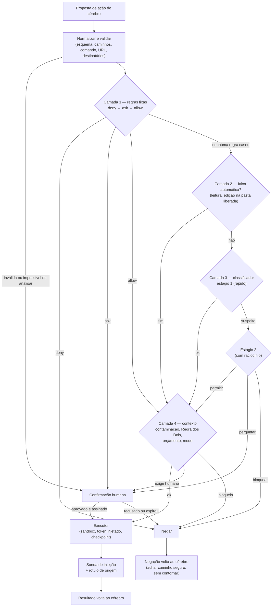

# Parte 3 — Política de segurança

> [Índice da documentação](README.md) · Parte 3 de 10 · as seções seguem a numeração 3.x

> Esta é a parte mais importante do documento. Ela se baseia em como o **Claude Code** e o **Claude no Chrome** tratam segurança e em pesquisa pública sobre agentes de IA (fontes na seção 3.1 e no [Apêndice D](referencias.md)).

## 3.0 As invariantes

**INVARIANTES: nunca podem ser enfraquecidas sem decisão explícita e registrada do dono do projeto.**

1. **Só o usuário dá ordens.** Tudo o que chega por ferramentas (e-mails, páginas, arquivos, issues, PDFs, imagens, transcrições) é **dado**, nunca instrução.
2. **A IA propõe, o Porteiro decide, o Executor executa.** O cérebro não tem como executar nada diretamente.
3. **`deny` vence tudo.** Nenhuma regra `allow`, gancho, arquivo de projeto, modelo ou modo de operação derruba uma negação.
4. **Na dúvida, bloqueia.** Erro, tempo esgotado, resposta ilegível do classificador ou comando que não dá para analisar = não executa (pergunta ou nega).
5. **Ação irreversível ou que fala com terceiros exige confirmação humana**, mostrando os parâmetros reais gerados por código.
6. **Voz pode parar o Jesus, mas não autoriza ação de alto risco.**
7. **Regra dos Dois:** se a tarefa já leu conteúdo não confiável **e** mexe com dados privados, qualquer ação de saída (enviar, publicar, convidar, executar com rede) precisa da sua confirmação.
8. **Segredos nunca entram** no contexto do modelo, nos logs, na memória ou na sandbox.
9. **Comandos do agente rodam contidos:** sem segredos no ambiente, com privilégios reduzidos e limites de recursos (modo padrão no Windows, seção 3.6) ou no WSL2 (modo avançado). Nunca como administrador, e nunca aceitam o aviso do UAC.
10. **O Jesus não altera a si mesmo:** nem regras, nem código, nem cofre, nem registro de auditoria, nem o próprio modo de permissão.
11. **Menor privilégio:** escopos OAuth mínimos, pedidos aos poucos; só as pastas que você liberar.
12. **Tudo é registrado** num registro só de acréscimo, que você pode ver e exportar.
13. **Proibições absolutas** (seção 3.4.9): dinheiro, senhas, criação de contas, configurações de segurança do sistema, apagar permanentemente, scripts baixados.
14. **O classificador não é fronteira de segurança.** Ele é uma camada. As fronteiras de verdade são o isolamento do sistema operacional, o menor privilégio e a confirmação humana.
15. **Trocar de modelo nunca muda as regras.**

## 3.1 O que a pesquisa ensina

### Como o Claude Code faz

**Modo automático** ([Anthropic Engineering, 25/03/2026](https://www.anthropic.com/engineering/claude-code-auto-mode)):

- **Ameaças consideradas:** comportamento "afobado" (fazer mais do que foi pedido), erros honestos, injeção de prompt e modelo desalinhado.
- **Duas camadas.** Uma **sonda de injeção** examina o que as ferramentas devolvem (arquivos, páginas, saída de comandos) e, se parecer tentativa de sequestro, anexa um aviso para o agente desconfiar e voltar ao pedido do usuário. Um **classificador de transcrição** avalia cada ação antes de executar, no lugar de um humano.
- **Cego ao raciocínio.** O classificador vê as mensagens do usuário e as chamadas de ferramenta, mas **não** vê o texto do agente nem os resultados das ferramentas. Motivo: as justificativas do agente poderiam convencê-lo, e tirar os resultados é a principal defesa contra conteúdo injetado. O custo é que ele não sabe se um recurso foi encontrado ou inventado pelo agente.
- **Dois estágios.** Um filtro rápido de uma palavra (sim/não), calibrado para errar para o lado do bloqueio; só o que for marcado vai para um segundo estágio com raciocínio, que reduz falsos positivos.
- **Três faixas.** Leituras e regras explícitas não passam pelo classificador; edições dentro do projeto também não (dá para revisar no git); todo o resto (comandos, web, integrações, subagentes, arquivos fora do projeto) passa. Ao entrar no modo automático, regras amplas que permitiriam execução arbitrária (shell liberado, interpretadores com curinga) são **descartadas**.
- **Regras do classificador.** Mais de 20 bloqueios em quatro grupos: **destruir ou exfiltrar**, **degradar a postura de segurança**, **cruzar fronteiras de confiança** e **burlar revisão ou afetar terceiros**, mais exceções estreitas. A intenção do usuário é lida de forma conservadora: o que o agente decidiu sozinho **não está autorizado** até o usuário dizer que está.
- **Negação.** Volta para o agente como resultado, com a orientação de achar um caminho mais seguro **sem contornar** o bloqueio. Depois de **3 negações seguidas ou 20 na sessão**, o controle volta para o humano.
- **Números honestos.** 0,4% de falsos positivos em 10.000 ações reais; **17% das ações "afobadas" reais passaram** (n=52); 5,7% das exfiltrações sintéticas passaram (n=1.000). A própria Anthropic diz que o modo **não substitui revisão humana cuidadosa** em infraestrutura crítica. A maioria das falhas aconteceu quando o classificador viu o perigo, mas achou que uma aprovação genérica do usuário cobria um efeito maior do que o pedido (ex.: "limpa o PR" não autoriza *force push*).

**Permissões** ([Permissions](https://code.claude.com/docs/en/permissions)):

- Ordem `deny → ask → allow`; uma negação ampla não pode ser furada por um `allow` específico; negação em qualquer nível de configuração vence.
- **Atenção:** regras sobre o *texto* do comando não pegam o mesmo programa chamado por outro caminho, dentro de `sh -c`, nem um script que abre arquivos por conta própria. Para garantia de verdade, a documentação manda usar a **sandbox do sistema operacional**.

**Proteções embutidas** ([Security](https://code.claude.com/docs/en/security)):

- Comandos de rede como `curl` e `wget` não são aprovados automaticamente.
- Páginas web são lidas por um modelo separado; o agente recebe só a resposta.
- Confirmação de confiança ao abrir uma pasta nova (*workspace trust*).
- Comando que não dá para analisar por completo sempre pergunta (**detecção de injeção de comando**).
- Comando sem regra correspondente pergunta (**falha fechada**).
- Nas sessões na nuvem, a credencial do GitHub **nunca entra na VM**: um proxy a anexa do lado de fora, e a VM recebe só uma credencial de curta duração.

**Caminhos protegidos e críticos** ([Permission modes](https://code.claude.com/docs/en/permission-modes)):

- Escrita em `.git`, `.vscode`, `.idea`, `.husky`, `.devcontainer`, `.claude` etc. nunca é automática.
- `rm`/`rmdir` na raiz do disco, na home, em `C:\` e `C:\Windows` ou na pasta de trabalho nunca é aprovado por regra. É um "disjuntor" contra erro do modelo.

**Bloqueios padrão do modo automático** (mesma fonte):

- baixar e executar código (`curl | bash`);
- enviar dados sensíveis para fora;
- deploys de produção e apagar em massa;
- dar permissões a alguém;
- *force push* e descartar mudanças não salvas (`git reset --hard`…);
- escrever em cofres de segredos;
- **imprimir credenciais** em arquivos ou na conversa;
- usar flags que desarmam proteções (`--insecure`);
- **lançar agentes autônomos sem aprovação ou sandbox**;
- enviar conteúdo, cookies ou credenciais de uma página para outro site;
- **incluir detalhes sensíveis em conteúdo enviado a terceiros** sem o usuário ter autorizado;
- **o agente mexer nas próprias permissões** (até enviar teclas para a própria interface);
- desativar testes que protegem segurança;
- apagar recursos que ele não criou e que você não nomeou.

### Como o Claude no Chrome faz

Fonte: [Claude for Chrome](https://claude.com/blog/claude-for-chrome), agosto a dezembro de 2025.

- Permissões por site; **confirmação antes de ações de alto risco: publicar, comprar, compartilhar dados pessoais**; categorias de sites **bloqueadas** (serviços financeiros, conteúdo adulto, pirataria).
- Testes adversariais (123 casos, 29 cenários): sem mitigações, **23,6%** dos ataques funcionaram no modo autônomo; com as mitigações, **11,2%**.
- Exemplo do teste: um e-mail malicioso dizia que mensagens precisavam ser apagadas "por segurança". Antes das defesas, o agente **apagou os e-mails sem confirmar**.
- Em novembro de 2025, a Anthropic relatou cerca de 1% de sucesso de um atacante adaptativo contra o Claude Opus 4.5 em navegação, e reforçou que **1% ainda é risco real** ([Prompt injection defenses](https://www.anthropic.com/research/prompt-injection-defenses)).

### O que deu errado (e o que ensina)

- **Agosto de 2026.** O pesquisador Johann Rehberger fez o Claude Code (Opus 5) no modo automático **executar código do atacante** a partir de um pedido inocente ("resuma esta página"). O truque foi plantar um `struct.py` na pasta de downloads para "sombrear" um módulo do Python. Funcionou em 60–80% de poucas tentativas; uma avaliação de terceiros encomendada pela Anthropic não tinha pego isso porque não cobria a técnica. A Anthropic classificou o caso como informativo, tratando o modo automático como recurso de conveniência, não como garantia ([BankInfoSecurity](https://www.bankinfosecurity.com/hidden-attack-slips-past-claude-code-auto-mode-a-32693); [análise](https://blakecrosley.com/blog/auto-mode-is-not-a-boundary)). **Lição:** classificador ajuda, mas a fronteira é o isolamento.
- **Nx "s1ngularity" (agosto de 2025).** Pacotes npm comprometidos usaram as **CLIs de IA instaladas na máquina da vítima** (Claude, Gemini, Q), com flags que desligam as permissões, para procurar segredos ([GitGuardian](https://blog.gitguardian.com/the-nx-s1ngularity-attack-inside-the-credential-leak/)). **Lição:** um agente com permissões amplas vira arma de malware local. O Jesus não pode ter um modo "sem freio" acessível por linha de comando.
- **Shai-Hulud (setembro de 2025 em diante).** Um "verme" se espalhou por centenas de pacotes npm roubando tokens via scripts de instalação ([Sysdig](https://sysdig.com/blog/shai-hulud-the-novel-self-replicating-worm-infecting-hundreds-of-npm-packages)).
- **LiteLLM (24/03/2026).** As versões 1.82.7 e 1.82.8 no PyPI saíram com código que rouba credenciais, depois do roubo da conta de publicação ([Datadog Security Labs](https://securitylabs.datadoghq.com/articles/litellm-compromised-pypi-teampcp-supply-chain-campaign/)). **Lição:** biblioteca de IA popular também é alvo; fixe versões e verifique.

### Princípios da comunidade de pesquisa

- **Tríade letal** (Simon Willison, junho de 2025): um agente com (1) acesso a dados privados, (2) exposição a conteúdo não confiável e (3) capacidade de se comunicar para fora pode ser induzido a vazar seus dados ([post](https://simonwillison.net/2025/Jun/16/the-lethal-trifecta/)).
- **Regra dos Dois** (Meta, outubro de 2025): numa sessão, o agente deve ter no máximo **duas** de três propriedades: [A] processar entrada não confiável, [B] acessar sistemas sensíveis ou dados privados, [C] mudar estado ou se comunicar para fora. Precisou das três? Coloque um **humano no meio** ([Meta AI](https://ai.meta.com/blog/practical-ai-agent-security/)).
- **"O atacante joga depois"** (pesquisadores da OpenAI, Anthropic, Google DeepMind e outros, outubro de 2025): ataques adaptativos quebraram **12 defesas publicadas**, com mais de 90% de sucesso na maioria, em defesas que diziam ter quase 0% ([arXiv 2510.09023](https://arxiv.org/abs/2510.09023)). **Lição:** detecção sozinha não basta; a arquitetura precisa limitar o estrago.
- **CaMeL** (Google DeepMind e ETH Zurich, 2025): um modelo **privilegiado** planeja só a partir do pedido do usuário; um modelo **em quarentena**, sem ferramentas, lê o conteúdo não confiável; um interpretador rastreia a origem de cada dado e aplica políticas a cada chamada. Resolveu 77% das tarefas do AgentDojo com garantias, contra 84% sem defesa ([arXiv 2503.18813](https://arxiv.org/abs/2503.18813)).
- **Padrões de projeto contra injeção** (ETH Zurich, IBM, Google, Microsoft e outros, 2025): *action-selector*, *plan-then-execute*, *map-reduce*, *dual LLM*, *code-then-execute* e *context-minimization* ([arXiv 2506.08837](https://arxiv.org/abs/2506.08837)).
- **Spotlighting** (Microsoft, 2024): marcar o conteúdo externo (delimitar, intercalar marcadores ou codificar) para o modelo distinguir dado de instrução. Nos testes do artigo, reduziu o sucesso de ataques de mais de 50% para menos de 2% ([arXiv 2403.14720](https://arxiv.org/abs/2403.14720)). É útil, mas ataques adaptativos ainda passam.
- **OWASP Top 10 para LLMs (2025):** LLM01 injeção de prompt, LLM02 vazamento de informação sensível, LLM03 cadeia de suprimentos, LLM04 envenenamento de dados e modelos, LLM05 tratamento inadequado de saída, LLM06 agência excessiva, LLM07 vazamento do prompt de sistema, LLM08 fraquezas de vetores e embeddings, LLM09 desinformação, LLM10 consumo sem limites.
- **OWASP Top 10 para aplicações agênticas (2026):** ASI01 sequestro de objetivo, ASI02 mau uso de ferramentas, ASI03 abuso de identidade e privilégio, ASI04 cadeia de suprimentos agêntica, ASI05 execução inesperada de código, ASI06 envenenamento de memória e contexto, ASI07 comunicação insegura entre agentes, ASI08 falhas em cascata, ASI09 exploração da confiança entre humano e agente, ASI10 agentes fora de controle ([OWASP](https://genai.owasp.org/resource/owasp-top-10-for-agentic-applications-for-2026/)).
- **MCP:** a especificação proíbe repassar tokens (*token passthrough*) e alerta para o "deputado confuso" ([MCP Security Best Practices](https://modelcontextprotocol.io/specification/latest/basic/security_best_practices)). Servidores podem esconder instruções nas descrições das ferramentas (**tool poisoning**) e trocar as definições depois de aprovados (**rug pull**) ([Invariant Labs](https://invariantlabs.ai/blog/mcp-security-notification-tool-poisoning-attacks)).

## 3.2 Modelo de ameaças

### O que proteger

| Ativo | Por que importa |
|---|---|
| Seus dados pessoais (PostgreSQL) | "Ele saberá tudo de mim": conversas, rotina, contatos, preferências, documentos |
| Contas conectadas (tokens OAuth) | Com o token, dá para ler e-mails, mandar mensagens em seu nome, mexer no GitHub |
| Seus arquivos e o próprio PC | Código, documentos, fotos; o Windows em si |
| Chaves de API dos modelos | Custam dinheiro e podem ser usadas por terceiros |
| Sua reputação | Mensagens, convites, comentários e publicações em seu nome |
| Seu dinheiro | Gasto com API e qualquer coisa que leve a pagamento |

### De onde vêm os problemas

| Origem | Exemplo | Impacto possível |
|---|---|---|
| **Injeção indireta** | E-mail, site, PDF, issue, convite de agenda, nome de arquivo ou legenda de imagem com ordens escondidas | Vazamento de dados, ações não pedidas |
| **Injeção por voz** | TV, vídeo ou outra pessoa dizendo "Ei, Jesus, …" | Ações não pedidas |
| **Agente afobado** | "Limpa minha caixa" vira apagar tudo; "organiza o repositório" vira *force push* | Perda de dados |
| **Erro honesto** | Apagar o arquivo errado; marcar evento no dia errado | Prejuízo pequeno a grande |
| **Servidor MCP malicioso** | Descrição envenenada; troca de definição depois de aprovado | Vazamento, execução de código |
| **Cadeia de suprimentos** | Pacote npm/PyPI comprometido, modelo baixado adulterado | Roubo de tokens, controle do PC |
| **Malware local** | Programa rodando como você lê o cofre do Windows (o DPAPI não protege contra o mesmo usuário) | Roubo de tokens e dados |
| **Envenenamento de memória** | Conteúdo externo salvo como "preferência" vira instrução no futuro | Ataque persistente |
| **Roubo do PC ou do disco** | Notebook perdido | Vazamento do banco |
| **Consumo sem limite** | Laço de ferramentas ou de modelo | Conta alta de API |
| **Modelo desalinhado** | O próprio modelo tentando burlar regras | Raro hoje, mas o desenho não pode depender de "o modelo é bonzinho" |

### A tríade no Jesus

O Jesus tem as três pernas da tríade letal o tempo todo: **[A]** lê e-mails, sites e arquivos; **[B]** tem sua memória, Gmail, Drive e arquivos; **[C]** envia e-mails, convida pessoas, faz push e roda comandos com rede. Por isso a Regra dos Dois é aplicada **por tarefa** (seção 3.4.6).

### Suposições e fora de escopo

- Supomos que o Windows não foi comprometido por um administrador malicioso (contra isso nenhum aplicativo resolve).
- O provedor de IA recebe a conversa que você manda para ele; escolher o provedor é decisão sua (seção 3.9).

## 3.3 Princípios

1. **Separação entre instruções e dados.** Pedidos do usuário são o único canal de ordens; o resto é dado rotulado com a origem.
2. **A IA propõe, o código decide.** Segurança mora fora do modelo.
3. **Defesa em profundidade.** Regras fixas + classificador + contexto + confirmação + isolamento. Nenhuma camada sozinha basta.
4. **Menor privilégio e menor agência** (OWASP LLM06). Só as ferramentas, pastas e escopos necessários.
5. **Falhar fechado.** Erro ou dúvida não executa.
6. **Reversível por padrão.** Rascunho antes de enviar, Lixeira antes de apagar, checkpoint antes de editar.
7. **Humano no circuito** para o que é externo ou irreversível.
8. **Transparência e auditoria.** Tudo visível e registrado.
9. **Privacidade por padrão.** Local primeiro; o mínimo vai para a nuvem.
10. **Independente de modelo.** As regras valem para qualquer modelo.

## 3.4 O Porteiro

### 3.4.1 Fluxo de decisão



- Na Camada 1, a primeira regra que casar decide, na ordem `deny → ask → allow`.
- Diferente do Claude Code, até ações liberadas por regra `allow` passam pela **Camada 4**: uma ação permitida pode virar perigosa se a tarefa estiver contaminada.
- Erro ou tempo esgotado em qualquer etapa → pergunta. Sem humano disponível (ex.: rotina agendada) → nega.

### 3.4.2 Normalização (antes de qualquer regra)

- **Esquema:** validar os parâmetros com Zod em modo estrito (campos desconhecidos = erro).
- **Caminhos no Windows:** resolver para caminho absoluto e canônico antes de comparar:
  - links simbólicos e *junctions* (`realpath`); comparação sem diferenciar maiúsculas e minúsculas;
  - nomes curtos 8.3 (`PROGRA~1`); prefixos `\\?\` e `\\.\`;
  - caminhos UNC (`\\servidor\pasta`): negados por padrão; o Claude Code alerta para o risco do WebDAV no Windows, que pode disparar requisições de rede escondidas;
  - fluxos alternativos (`arquivo.txt:fluxo`), pontos e espaços no fim do nome, nomes reservados (`CON`, `NUL`).
  - Como no Claude Code, a negação vale se o caminho pedido **ou** o destino real casar com a regra.
- **Comandos:**
  - analisar com parser de verdade (bash via `tree-sitter`; PowerShell via o próprio parser de AST do PowerShell);
  - comandos compostos (`&&`, `;`, `|`, subshells, `$( )`) são avaliados por partes **e** como um todo;
  - redirecionamentos (`>`, `>>`, `2>`, `<`, `tee`) são checados contra as regras de arquivo;
  - **não deu para analisar → pergunta**;
  - ofuscação (`-EncodedCommand`, `iex`, `Invoke-Expression`, `cmd /c` aninhado, comando montado por variáveis) → nível alto.
- **Script escrito e depois executado:** o **conteúdo** do script é avaliado, não só o comando que o executa (o Claude Code faz o mesmo).
- **URLs:** normalizar (IDN/punycode), extrair o domínio registrável, detectar dados na query string (vazamento via URL).
- **Destinatários:** normalizar e-mails e marcar se cada um veio do usuário, dos contatos aprovados ou de conteúdo externo.

### 3.4.3 Camada 1 — Regras fixas

Sintaxe proposta, inspirada no Claude Code: `ferramenta(especificador)`. Para comandos, o especificador é um padrão do comando; para ferramentas de API, é `parametro:padrao`.

```jsonc
// regras do nível "usuário" (editadas só pela interface)
{
  "deny": [
    "arquivo.*(~/.ssh/**)",
    "arquivo.*(**/*.kdbx)",
    "arquivo.*(%LOCALAPPDATA%/Jesus/**)",          // dados: senha local, cofre, banco
    "arquivo.*(%LOCALAPPDATA%/Programs/Jesus/**)", // instalação: o próprio app (inclui resources/)
    "terminal(*Set-ExecutionPolicy*)",
    "terminal(* | iex*)",
    "gmail.criar_filtro(*)"
  ],
  "ask": [
    "terminal(git push*)",
    "terminal(npm install *)",
    "agenda.criar(convidados:*)"
  ],
  "allow": [
    "terminal(git status)",
    "terminal(git diff*)",
    "terminal(npm test)",
    "web.ler(dominio:developer.mozilla.org)"
  ]
}
```

**Níveis de configuração:**

| Nível | Quem edita | O que pode |
|---|---|---|
| **Fábrica** | código do Jesus (versão assinada) | define as proibições absolutas, que nenhum outro nível desfaz |
| **Usuário** | você, pela interface | restringir e liberar (exceto proibições) |
| **Projeto** (`JESUS.md`, `.jesus/regras`) | quem escreveu o repositório | **só restringir** |
| **Sessão** | você, durante a conversa ("pode rodar os testes à vontade") | liberações temporárias de risco baixo ou médio |

Uma negação em qualquer nível vence uma liberação em qualquer outro (igual ao Claude Code).

**Caminhos protegidos (escrita nunca é automática):** `.git/`, `.github/workflows/`, `.vscode/`, `.idea/`, `.husky/`, `.devcontainer/`, `.npmrc`, `.yarnrc*`, `pip.conf`, `JESUS.md` e `.jesus/`, perfis de shell (`$PROFILE`, `.bashrc`, `.zshrc`), pasta de inicialização do Windows, tarefas agendadas, chaves `Run` do registro.

**Caminhos críticos (nunca apagar, nem com regra):** raízes de unidade (`C:\`), `C:\Windows`, `C:\Program Files*`, `C:\Users\<você>` e as pastas raiz Documentos, Área de Trabalho, Imagens e Downloads, a raiz da pasta de trabalho e as pastas acima dela, e as pastas do Jesus.

**Leitura sensível (negada por padrão):**

- `~/.ssh`, `~/.aws`, `~/.azure`, `~/.config/gcloud`, `~/.kube`, `~/.docker/config.json`;
- `~/.git-credentials`, `~/.npmrc` (pode ter tokens);
- perfis de navegador (cookies e senhas salvas) e arquivos de gerenciador de senhas (`*.kdbx`);
- `%APPDATA%\Microsoft\Protect` (chaves do DPAPI) e carteiras de cripto;
- `.env*`: liberável por projeto, mas **o valor nunca vai para o modelo** (seção 3.5).

### 3.4.4 Camada 2 — Faixa automática

- Leituras dentro das pastas liberadas → executa.
- Edições dentro das pastas liberadas → executa com checkpoint (exceto caminhos protegidos).
- **Primeira leitura fora** das pastas liberadas → pergunta (igual ao Claude Code).
- Leituras nas suas contas (listar eventos, listar e-mails) → executa, mas **ler o conteúdo de e-mails e páginas marca a tarefa como contaminada**.

### 3.4.5 Camada 3 — Classificador de risco

**O que ele vê:**

- As mensagens **do usuário** nesta tarefa (texto literal).
- A ação proposta: ferramenta + parâmetros completos.
- Metadados da ferramenta (efeitos, reversível ou não, envia dados para fora ou não).
- A descrição do ambiente, ou seja, a fronteira de confiança: pastas liberadas, suas contas, seus contatos aprovados, domínios confiáveis.
- O estado da tarefa (limpa, contaminada ou suspeita) e **a origem de cada parâmetro** (ex.: "o destinatário apareceu num e-mail recebido, não no pedido do usuário").

**O que ele NÃO vê** (como no Claude Code):

- o texto e o raciocínio do cérebro;
- os resultados das ferramentas e o conteúdo externo cru;
- as descrições de ferramentas escritas por servidores MCP.

**Como decide:**

- Template fixo com três partes editáveis: **Ambiente**, **Regras de bloqueio** e **Exceções permitidas** (o mesmo desenho da Anthropic). Rascunho no [Apêndice B](prompts.md).
- Grupos de bloqueio: destruir ou exfiltrar · degradar segurança · cruzar fronteira de confiança · burlar revisão ou afetar terceiros.
- Avalia o **efeito real**, não o texto: comandos encadeados contam como uma ação; script escrito e executado é avaliado pelo conteúdo.
- **Intenção do usuário, lida de forma conservadora:** o que o agente escolheu sozinho não está autorizado; uma aprovação genérica não cobre um efeito maior do que o pedido.
- **Dois estágios:** (1) resposta de uma palavra, calibrada para bloquear na dúvida; (2) só se o estágio 1 marcar, avaliação com raciocínio.
- Temperatura 0; tempo limite (ex.: 8 s). Resposta que não for JSON válido = sem veredito = **não executa**.

**Saída (JSON):**

```json
{
  "decisao": "permitir | perguntar | bloquear",
  "nivel": "baixo | medio | alto | proibido",
  "categorias": ["exfiltracao", "destrutivo", "terceiros", "seguranca", "fronteira"],
  "intencao_do_usuario_cobre": true,
  "suspeita_de_injecao": false,
  "motivo": "frase curta em português para o registro e para o cartão de confirmação"
}
```

**Depois de negar:** a negação volta ao cérebro como resultado ("bloqueado: <motivo>. Procure um caminho mais seguro; não tente contornar"). **3 negações seguidas ou 20 na sessão** → o Jesus para e chama você.

**Qual modelo usar:** o mais confiável que você tiver configurado. Ele é chamado poucas vezes por tarefa, então o custo é baixo. Se o modelo escolhido for fraco, a interface avisa.

### 3.4.6 Camada 4 — Contexto: contaminação e Regra dos Dois

**Estados da tarefa:**

| Estado | Quando | Efeito |
|---|---|---|
| **Limpa** | só pedidos seus e dados locais | regras normais |
| **Contaminada** | leu e-mail, site, documento externo, issue, PDF… | ações de saída sobem de nível |
| **Suspeita** | a sonda de injeção marcou algo, ou um subagente voltou com histórico estranho | ações de saída **bloqueadas**; só leitura até você revisar |

**Origem de cada valor:** todo dado que veio de fora carrega a origem (ex.: `email:msg-123`). Quando um parâmetro de ação (destinatário, URL, comando, caminho) vem de conteúdo externo, o Porteiro sabe.

**Regra dos Dois aplicada:**

| [A] leu algo não confiável | [B] mexe com dados privados | [C] muda estado ou envia para fora | Decisão |
|---|---|---|---|
| sim | sim | sim | **confirmação humana obrigatória** (nível alto) |
| sim | sim | não | ok (só leitura ou rascunho) |
| sim | não | sim | ok, passando pelo classificador (ex.: pesquisar e salvar num arquivo da pasta) |
| não | sim | sim | regras normais |

**Controle de saída:**

- Destinatários aceitos sem pergunta: você mesmo e contatos que **você** aprovou para envio.
- Destinatário novo → pergunta. Destinatário novo + tarefa contaminada → alto.
- Destinatário que só apareceu em conteúdo externo + ação de envio → **bloqueio**. É o padrão clássico do ataque de vazamento.
- URL com dados na query string para domínio não confiável → pergunta ou bloqueio.
- A sandbox não tem rede livre: cada comando declara os domínios que precisa, como no Claude Code.

**Orçamento:** limites por tarefa e por dia (passos, chamadas, tempo, custo). Estourou → para e pergunta.

### 3.4.7 Confirmação humana

**O cartão de confirmação:**

- É **gerado por código** a partir dos parâmetros reais (`resumoParaAprovacao`), nunca por texto do modelo.
- Mostra: a ferramenta; os parâmetros completos; os efeitos externos ("o Google enviará um convite"); o **diff**, em edições; o comando **literal**, em comandos; destinatários marcados como **novo** ou **externo**; o nível de risco; e por que o Porteiro pediu confirmação.
- Mostra a origem do pedido: "nasceu do seu comando de voz às 14:32" ou, com alerta, "nasceu de um e-mail recebido".

**Canal por nível:**

| Nível | Como confirmar |
|---|---|
| Médio | voz ("sim, pode") ou clique |
| Alto | clique ou tecla com a janela em foco, ou Windows Hello/PIN, **nunca só voz** |
| Proibido | não existe confirmação: ele explica e você faz |

**Antifraude:**

- A área de confirmação é um componente **confiável** da interface. O texto do modelo não consegue desenhar botões nem imitar o cartão.
- A aprovação é **assinada (HMAC)** e amarrada ao identificador da chamada + hash dos parâmetros; expira (ex.: 2 min); qualquer mudança de parâmetro exige nova aprovação. O AI SDK já oferece assinatura de aprovações (`experimental_toolApprovalSecret`).
- O Executor **revalida** a assinatura antes de executar e não aceita "já aprovado" vindo do cérebro.
- Sem resposta → cancela.
- "Sempre permitir" só existe para risco baixo e médio e fica escopado (projeto, ferramenta, padrão); **nunca** para alto.

**Tela "Permissões" (pedido do dono do projeto):** toda permissão que você deu fica numa lista que você vê e remove quando quiser.

- Cada linha mostra o que foi liberado (ex.: "abrir o VS Code"), o escopo (pasta, projeto ou sempre), quando e como você liberou (clique ou voz) e quantas vezes já foi usada.
- **Remover vale na hora**, inclusive para uma tarefa em andamento: a próxima ação igual volta a pedir confirmação. Dá para remover uma a uma ou todas de uma vez ("voltar ao padrão").
- Fica guardada em `regras_usuario` ([05](05-dados-postgresql.md), seção 5.5), com versões: dá para ver o histórico do que foi dado e tirado. A auditoria registra cada mudança.
- **Só você mexe nela**, pela interface. O Jesus não dá nem amplia permissão para si mesmo (invariante 7). Ele pode só **abrir a tela** quando você pedir ("Jesus, mostra minhas permissões").

**Fadiga de aprovação:** a própria Meta lembra que o modelo quebra quando o usuário aprova sem ler. Por isso: não pedir confirmação para o que é seguro, agrupar aprovações de baixo risco e deixar o cartão de alto risco visualmente diferente (âmbar ou vermelho, as únicas cores que o holograma usa).

### 3.4.8 Níveis de risco por domínio

| Domínio | Baixo (executa) | Médio (pergunta: voz ou clique) | Alto (clique ou Windows Hello) |
|---|---|---|---|
| **Arquivos** | ler, listar, buscar e editar nas pastas liberadas | criar fora do projeto; mover para a Lixeira; editar caminho protegido | apagar em massa; mexer fora das pastas liberadas |
| **Terminal** | comandos de leitura (`git status`, `dir`, `ls`), testes e build na sandbox | instalar dependências; comandos com rede na sandbox; comandos da lista fechada do Windows | qualquer comando que mude o sistema; comandos ofuscados |
| **Git/GitHub** | `diff`, `log`, commit local, criar branch | push na branch de trabalho; abrir PR; comentar numa issue sua | push na branch principal; *force push*; apagar branch remota; merge; mudar permissões ou visibilidade |
| **Web** | pesquisar; ler página (quarentena) | baixar arquivo (para a pasta de quarentena) | enviar formulário |
| **Agenda** | listar; criar ou editar evento **só seu** | convidar pessoas; editar evento de outra pessoa | apagar eventos em massa; responder em nome de outros |
| **E-mail** | listar; ler (quarentena); criar rascunho | — | enviar; responder; encaminhar; criar filtros, regras ou encaminhamento automático |
| **Drive** | listar; ler | criar arquivo; mover | compartilhar; tornar público; apagar |
| **Contatos** | buscar | criar ou editar | apagar |
| **Memória** | buscar; salvar fato que **você** disse | salvar fato inferido; esquecer um item | apagar tudo; exportar |
| **Contas** | — | conectar conta (você faz o login na página oficial) | ampliar escopo; desconectar perdendo dados |
| **Jesus** | ver registro; ver regras | liberar pasta nova; regra de sessão | mudar para um modo menos seguro; editar regras do usuário |
| **Sistema** | ver informações | abrir um programa | qualquer alteração de configuração |

### 3.4.9 Proibições absolutas

O Jesus **nunca** faz o que está abaixo, mesmo que você peça, mesmo com todos os detalhes, mesmo que diga que autoriza. Ele explica e você faz. A lista é inspirada nas regras que o próprio Claude segue quando age no navegador e no computador:

1. Digitar senhas, códigos 2FA, números de cartão ou conta, CPF/RG/passaporte ou chaves de API em qualquer campo ou site.
2. Criar contas ou fazer login por você.
3. Qualquer transação financeira: comprar, pagar, Pix, transferir, investir, cripto.
4. Apagar permanentemente (esvaziar a lixeira, apagar e-mails ou arquivos sem volta).
5. Alterar configurações de segurança do Windows: antivírus, firewall, UAC, BitLocker, políticas, registro de segurança, `Set-ExecutionPolicy`; desligar o Defender.
6. Resolver CAPTCHAs ou burlar detecção de robôs.
7. Baixar e executar arquivos ou scripts da internet fora da sandbox (`curl … | sh`, `iwr … | iex`).
8. Alterar a si mesmo: regras, código, cofre, auditoria, modo de permissão; enviar teclas ou cliques para a própria interface.
9. Lançar outro agente autônomo sem aprovação ou sem sandbox (flags do tipo "pular permissões").
10. Imprimir credenciais em arquivos, na conversa ou no registro.
11. Usar o navegador do agente em sites de categorias bloqueadas: bancos e serviços financeiros, conteúdo adulto, pirataria.
12. Dar aconselhamento financeiro personalizado como se fosse um profissional.

### 3.4.10 Defesas contra injeção: onde cada uma mora

| Defesa | Base | Onde fica no Jesus |
|---|---|---|
| Só o usuário dá ordens | regras do Claude; OWASP LLM01 | prompt de sistema + Porteiro |
| Rotular o conteúdo externo (*spotlighting*) | Microsoft, 2024 | o Executor embrulha os resultados: `<conteudo_externo origem="…" confiavel="nao">` |
| Leitor em quarentena | CaMeL; padrão *dual LLM*; WebFetch do Claude Code | `web.ler`, `gmail.ler`: um modelo sem ferramentas extrai só o que foi pedido |
| Minimizar o contexto | padrões de projeto, 2025 | só os trechos necessários entram no contexto |
| Planejar antes de ler | *plan-then-execute* | modo Planejar; o plano é fixado antes de ler conteúdo externo |
| Sonda de injeção | modo automático do Claude Code | detector nos resultados (modelo pequeno ou classificador dedicado, como o Prompt Guard da Meta) |
| Classificador cego ao raciocínio | modo automático do Claude Code | Camada 3 |
| Contaminação + Regra dos Dois | Willison; Meta | Camada 4 |
| Controle de saída | Claude Code (vazamento bloqueado por padrão) | destinatários, URLs e rede da sandbox |
| Humano no circuito | Claude no Chrome (publicar, comprar, compartilhar) | cartões de confirmação |
| Contenção pelo sistema operacional | sandbox do Claude Code; caso Rehberger | processo contido no Windows (token restrito + Job Object); AppContainer como upgrade; WSL2 opcional |
| Menor privilégio | OWASP LLM06 | escopos OAuth mínimos, pastas liberadas |
| Não renderizar conteúdo remoto | vazamento via imagem em markdown | a interface não carrega imagens remotas sozinha |

## 3.5 Credenciais, tokens e segredos

- **Onde ficam:** chaves de API dos modelos e tokens OAuth ficam criptografados com o `safeStorage` do Electron (DPAPI no Windows) ou no Gerenciador de Credenciais. **Nunca** em texto puro, no PostgreSQL sem criptografia, em `.env` do repositório ou em variáveis de ambiente de processos que o agente controla.
- **Limite importante do DPAPI:** ele protege contra **outros usuários** do PC, mas **qualquer programa rodando como você** consegue pedir a descriptografia. A documentação do Electron diz isso explicitamente ([Electron safeStorage](https://electronjs.org/docs/latest/api/safe-storage)). Consequências: comandos do agente **não podem rodar como você no Windows** com acesso livre (por isso a sandbox da seção 3.6), e tokens devem ser de curta duração e revogáveis sempre que possível.
- **Quem usa os tokens:** só o Executor. Ele injeta o token na chamada HTTP no último momento, o mesmo desenho do proxy de GitHub das sessões na nuvem do Claude Code. Nem a IA nem a sandbox veem o token.
- **Mascarar segredos:** antes de mandar qualquer texto para um modelo, para o registro, para os logs ou para a memória, um filtro procura e mascara padrões de segredo (`maskSecrets`, em `packages/shared`; [decisão 0022](decisoes/0022-registro-de-auditoria-e-mascaramento.md)):
  - chaves `sk-…`/`sk-ant-…`, `ghp_…`/`ghs_…`/`github_pat_…`, `AIza…`/`GOCSPX-…`, `xox…`, AWS, Stripe, npm e outras com prefixo;
  - `Bearer`, JWTs e chaves privadas (`-----BEGIN … PRIVATE KEY-----`);
  - senha em string de conexão, senha por atribuição ou por proximidade de palavra-chave, códigos de verificação e de login, código de segurança e número de cartão (fica o final);
  - tokens de alta entropia.
  - É idempotente (mascarar de novo não muda nada). O logger também tira campos com nome de segredo (`password`, `token`, `cookie`…) inteiros.
  - Se encontrar um segredo num parâmetro de ação com destino externo → **bloqueio**.
- **Sua senha:** o Jesus nunca pede, guarda ou digita. O login é sempre você, na página oficial (OAuth).
- **A senha do próprio Jesus** (para abrir o app, seção 3.20) é outra coisa: fica só como hash bcrypt e nunca é usada com nenhum provedor.
- **Hash não é cifra.** O bcrypt serve para conferir senhas; o que precisa ser lido de volta (campos sensíveis, backups) é cifrado com AES-256-GCM, com a chave protegida pelo cofre ([decisão 0015](decisoes/0015-senha-local-com-bcrypt-e-dados-cifrados.md)).
- **`.env`:** pode ser liberado por projeto, mas o Executor injeta os valores nos processos da sandbox que precisarem. **O modelo vê só os nomes** das variáveis.
- **Rotação e revogação:** o botão "desconectar" revoga o token na API do provedor e apaga do cofre. Num incidente, "revogar tudo" com um clique (seção 3.18).

## 3.6 Isolamento de execução (terminal e código)

**Por que isolar:** regras sobre o texto de um comando são fáceis de burlar (outro caminho, `sh -c`, script que abre arquivos sozinho), e a própria documentação do Claude Code avisa isso. A fronteira de verdade é o sistema operacional.

**No Windows 11 Home (o seu caso):** o *Windows Sandbox* e o gerenciador do Hyper-V **não** estão disponíveis na edição Home. O **WSL2** e o **Docker Desktop (com WSL2)** estão. O próprio Claude Code não tem sandbox no Windows nativo: lá, os comandos rodam direto no Windows (Git Bash/PowerShell) protegidos só por permissões, e quem quer isolamento roda o Claude Code dentro do WSL2.

**Decisão (07/10/2026): igual ao Claude Code no Windows, nada externo para instalar.** Por padrão, os comandos rodam **direto no Windows (PowerShell)**, sem WSL2 nem Docker. O WSL2 fica como **opção avançada** que o usuário pode ligar depois. Como não há caixa de isolamento por padrão, valem as **compensações** abaixo.

Neste documento, **"sandbox"** significa o ambiente de execução contido: no modo padrão, o processo do Windows com as compensações abaixo; no modo avançado, o WSL2.

### Modo padrão: Windows nativo + compensações

Sem sandbox do sistema, o Porteiro passa a ser a barreira principal. Por isso ele fica **mais rígido** que no modo com WSL2:

| Compensação | Como funciona | Usa só o que o Windows já tem? |
|---|---|---|
| **Todo comando passa pelo Porteiro** | só uma lista curta de comandos de leitura (`git status`, `git diff`, `dir`, testes do projeto) roda sem classificador; o resto passa pelo classificador; comando com rede, ofuscado ou que não dá para analisar **sempre pergunta** | sim |
| **Pasta de trabalho travada** | o processo começa na pasta do projeto; caminhos fora dela em argumentos e redirecionamentos são checados (seção 3.4.2) | sim |
| **Ambiente limpo** | o processo do comando recebe variáveis de ambiente mínimas: **nenhum token, chave ou `.env`** (só o Executor tem os segredos) | sim |
| **Token restrito do Windows** | o comando roda com privilégios reduzidos (*restricted token* / nível de integridade baixo), o que bloqueia escrita na maior parte do perfil do usuário e do sistema | sim (APIs nativas do Windows, via módulo nativo pequeno) |
| **Job Object** | limita memória, CPU, tempo e número de processos; ao cancelar, mata a árvore inteira de processos (o botão de emergência funciona de verdade) | sim |
| **Sem elevação** | se o comando pedir administrador (UAC), aborta | sim |
| **Nada de scripts baixados** | nunca executar arquivos da pasta de downloads ou da quarentena; `curl \| sh` e `iwr \| iex` proibidos (seção 3.4.9) | sim |
| **Risco mais alto para escrita** | comandos que escrevem fora do projeto ou instalam algo sobem um nível de risco (médio → alto) | sim |

**Limite honesto do modo padrão:** um processo com privilégios reduzidos ainda consegue **ler** boa parte dos seus arquivos (o Windows bloqueia por padrão a escrita "para cima", não a leitura). Por isso: (1) o token restrito usa *SIDs de restrição*, para que as pastas do Jesus (cofre, banco, regras) e os caminhos sensíveis neguem acesso a esse processo; (2) o Porteiro trata como **alto** qualquer comando que leia fora do projeto; (3) a rede não é bloqueada pelo sistema sem privilégio de administrador, então comandos com rede **sempre perguntam**. Ferramentas como git e npm podem precisar de permissões extras sob token restrito; isso precisa ser testado no Windows (fase 3).

**Evolução (sem baixar nada):** o Windows já traz o **AppContainer**, o mesmo isolamento que o Edge e o Chrome usam nas abas. Um processo num AppContainer só enxerga as pastas e a rede que você liberar. É mais complexo de implementar (exige um módulo nativo), então entra numa fase posterior como upgrade do modo padrão.

### Modo avançado (opcional): WSL2

Para quem quiser a "caixa fechada" de verdade, equivalente a rodar o Claude Code com `/sandbox` dentro do WSL2:

| Onde roda | O quê | Isolamento |
|---|---|---|
| **Distro WSL2 dedicada ("jesus-sandbox")** | comandos de programação: testes, build, scripts, gerenciadores de pacote | só a pasta do projeto montada; usuário Linux sem sudo; rede por lista de domínios via proxy; limites de CPU, memória e tempo |
| **Windows (lista fechada)** | o que só existe no Windows (abrir um programa, consultar informações) | comandos pré-aprovados, parâmetros validados, sem elevação |

Com o WSL2 ligado, o Porteiro pode relaxar um pouco para comandos que rodam lá dentro (ex.: instalar dependências declaradas = baixo).

**Configuração da distro WSL2** (`/etc/wsl.conf`):

```ini
[automount]
enabled = false          # não monta o C: inteiro; a pasta do projeto é montada de forma explícita

[interop]
enabled = false          # impede rodar programas .exe do Windows de dentro da sandbox
appendWindowsPath = false
```

**Regras adicionais:**

- **Nunca administrador.** O Jesus roda sem elevação; se um comando disparar o UAC, ele aborta.
- **Tempo e saída:** tempo máximo por comando (ex.: 5 min, configurável) e saída truncada (ex.: 30 mil caracteres).
- **Pacotes:**
  - instalar o que já está no lockfile ou manifesto = médio;
  - pacote novo = pergunta, mostrando nome, versão, autor e data de publicação, com alerta para pacotes muito novos ou com nome parecido com outro (*typosquatting*);
  - preferir `npm ci` (ou o equivalente com lockfile congelado do gerenciador do projeto);
  - scripts de instalação desligados por padrão quando possível.
- **Sombreamento de módulo (caso Rehberger):** a sandbox não executa nada a partir da pasta de downloads ou de pastas com arquivos recém-baixados; Python roda com `-I` (modo isolado), e o diretório de trabalho de scripts é o do projeto.
- **Rede:** cada comando declara os domínios de que precisa (ex.: `registry.npmjs.org`), e o Porteiro avalia isso junto com o comando, como no Claude Code. No modo padrão, o controle é só do Porteiro (comando com rede pergunta). No AppContainer (upgrade), a rede fica fechada sem a capacidade `internetClient`; no WSL2, fica fechada e abre por lista de domínios via proxy.

## 3.7 Web, navegador e downloads

- Resultados de pesquisa e páginas são **não confiáveis** e passam pelo leitor em quarentena.
- O agente **não** envia formulários, não faz login e não aceita termos ou cookies em seu nome. No MVP, o Jesus nem tem um navegador controlável; quando tiver, seguirá as regras do Claude no Chrome (permissão por site, confirmação para publicar, comprar ou compartilhar dados, categorias bloqueadas).
- Downloads vão para uma pasta de **quarentena** e nunca são executados; abrir um download é com você.
- Nada de buscar URLs montadas a partir de conteúdo externo com dados seus nos parâmetros.

## 3.8 Integrações, OAuth e MCP

- **OAuth sempre pelo navegador padrão**, com PKCE e retorno em `127.0.0.1` (detalhes na [Parte 6](06-integracoes.md)). Nunca janela embutida: o Google bloqueia, e é inseguro, porque o app poderia ler o que você digita.
- **Escopos mínimos e incrementais.** A interface mostra cada conta como satélite com o nível de acesso (leitura ou escrita).
- **MCP:**
  - Só servidores oficiais ou que você revisou, com versão fixada e o **hash das definições** guardado. Se a descrição de uma ferramenta mudar, ela fica desativada até você aprovar de novo (contra *rug pull*).
  - Descrições de ferramentas MCP são **não confiáveis**: não vão para o classificador e são mostradas para você revisar.
  - Servidores locais rodam como processos isolados (de preferência na sandbox), com só as variáveis de ambiente necessárias.
  - Servidores remotos usam OAuth conforme a especificação do MCP. **Proibido repassar tokens** de um serviço para outro (*token passthrough*).
  - Nomes de ferramentas levam o prefixo do servidor (`mcp__servidor__ferramenta`), para que um servidor não consiga "imitar" a ferramenta de outro.
  - Antes de instalar um servidor, auditar com o `mcp-scan` (da Invariant Labs).

## 3.9 Privacidade e dados pessoais

- **Local primeiro:** o PostgreSQL só escuta em `localhost`, com senha aleatória guardada no cofre, sem acesso remoto ([Parte 5](05-dados-postgresql.md)).
- **Criptografia em repouso:** ligar a criptografia do dispositivo/BitLocker no Windows; campos muito sensíveis criptografados pela aplicação (AES-256-GCM, chave no cofre); backups criptografados.
- **O que vai para a nuvem:** só o necessário para a tarefa vai para o provedor de IA. Política por categoria: dados de saúde, documentos pessoais e finanças vão **só para modelo local** (Ollama) por padrão, ou para a nuvem com sua confirmação.
- **Minimização:** o cérebro recebe trechos, não caixas de e-mail inteiras.
- **Retenção:** você define por quanto tempo guardar conversas, resultados de ferramentas e registros. "Esquecer" apaga de verdade e sai dos backups seguintes.
- **Embeddings também são dados pessoais:** vetores podem vazar informação do texto original, então recebem a mesma proteção.
- **Provedores:** escolha provedores e planos cujas políticas de uso e retenção de dados você aceita, e confira a política de cada um.

## 3.10 Memória de longo prazo (contra envenenamento, OWASP ASI06)

- Toda memória tem **origem** (você disse, inferida de conversa ou vinda de conteúdo externo) e **confiança**.
- **Conteúdo externo nunca vira instrução** na memória. No máximo vira "fato observado, origem: e-mail X", apresentado ao modelo como dado.
- Memórias inferidas ficam **pendentes** até você revisar, ou marcadas como "não confirmadas".
- Memórias são recuperadas como dados, numa seção rotulada, nunca coladas no prompt de sistema.
- Você pode ver, editar, exportar e apagar qualquer memória ("Jesus, o que você sabe sobre mim?").
- O modelo **nunca** recebe acesso SQL ao banco: só ferramentas estruturadas (`memoria.buscar`, `memoria.salvar`, `memoria.esquecer`).

## 3.11 Voz

- Ativação por **"Ei, Jesus"** + tecla de segurar-para-falar. Se houver muitas ativações acidentais, aumentar o limiar ou desligar a palavra de ativação.
- **Voz nunca autoriza nível alto.** Nível médio pode ser confirmado por voz **se** o pedido original também veio de você (e não de conteúdo externo).
- "Jesus, pare" ou "cancela" **sempre** funciona e interrompe tudo. Parar é seguro, por isso a voz pode.
- Áudio de outros programas (vídeo, música) é tratado como possível injeção. O cancelamento de eco ajuda, e com mídia tocando o Jesus fica mais exigente.
- Reconhecimento de quem fala (biometria de voz) **não** é usado como autorização, porque é falsificável.
- O áudio é processado localmente por padrão; as gravações não são guardadas, só a transcrição (configurável).

## 3.12 Interface (Electron)

Seguir a lista oficial de segurança do Electron ([Electron Security](https://electronjs.org/docs/latest/tutorial/security)):

- `contextIsolation: true`, `sandbox: true` e `nodeIntegration: false` em toda janela; `contextBridge` com uma API mínima.
- CSP restritiva (`script-src 'self'`), sem `eval`; nenhum conteúdo remoto nas janelas do app.
- Bloquear navegação e novas janelas; `shell.openExternal` só para URLs de uma lista (ex.: páginas de login OAuth).
- Validar a origem de toda mensagem IPC.
- Markdown vindo do modelo é renderizado com sanitização e **sem carregar imagens remotas** sozinho. Esse é um canal clássico de vazamento: ``.
- Protocolo próprio em vez de `file://`: a janela carrega `https://jesus.invalid/`, um endereço que não existe na internet, atendido pelo `protocol.handle` do Electron (decisão 0016).
- **Interface em Next.js com servidor ([decisão 0016](decisoes/0016-nextjs-com-servidor-dentro-do-electron.md), que substitui a exportação estática da 0013):** páginas, Server Actions e rotas são o back-end da interface, mas **o app instalado não abre porta**: o Electron entrega ao servidor do Next, dentro do próprio app, só os pedidos da janela do Jesus para `https://jesus.invalid/` e recusa qualquer outro endereço. Outros programas e sites não alcançam esse back-end.
  - **Lista de `Host`** (`src/server/host.ts`): o proxy responde 421 a qualquer pedido cujo `Host` (ou `X-Forwarded-Host`) não seja `127.0.0.1`, `localhost`, `[::1]` ou `jesus.invalid`, antes de qualquer página ou ação. É a defesa contra *DNS rebinding* no servidor com porta (desenvolvimento e `next start`): nesse ataque, `Origin` e `Host` trazem o nome do site do atacante e batem entre si, então a checagem de origem do Next sozinha não basta. O proxy confere todo pedido, menos os arquivos de `/_next/static/`; não há exceção por cabeçalho (um pedido com `next-router-prefetch` também passa pela lista). No app instalado (`JESUS_HTTPS=1`), a lista fica só com `jesus.invalid`.
  - **Processo próprio ([decisão 0017](decisoes/0017-servidor-do-next-num-utilityprocess.md)):** o servidor do Next roda no utilityProcess `jesus-next`. Ele só fala com o principal por uma ponte de mensagens conferidas com Zod estrito: pedido de até 2 MB, só `https://jesus.invalid`, só GET, HEAD e POST, e resposta com contrapressão.
    - Sem rede: o `fetch` falha fechado, menos o repasse interno de Server Action do próprio Next, atendido em memória.
    - Se o processo cair, o pedido em andamento é interrompido (nunca chega pela metade como se estivesse inteiro), e o processo novo começa bloqueado.
    - A montagem do build para o app (`stage-ui.mjs`) recusa `.env*`, a pasta `.jesus-dev`, credenciais, chaves, bancos e módulos nativos.
    - Limite: o utilityProcess não tem a sandbox do Chromium. A separação protege contra travamento e vazamento por acidente, não contra execução de código no processo do Next.
  - **CSP com nonce novo a cada pedido** (`src/proxy.ts`): `script-src 'self' 'nonce-…' 'strict-dynamic'` e estilos com o mesmo nonce, sem `unsafe-inline`; `unsafe-eval` só no desenvolvimento. Mais `X-Frame-Options: DENY`, `nosniff`, `no-referrer` e `Permissions-Policy`. O Zod roda sem JIT para não tentar `new Function`. As telas de 404 e de erro geral são do próprio app (`app/not-found.tsx`, `app/global-error.tsx`), só com classes CSS: as padrão do Next usam estilos inline, que a CSP bloqueia. O teste no Chromium não acusou violação nas telas de entrada, início, Cenários, 404 e erro geral.
  - **Server Actions são pontos de entrada:** só aceitam POST com a mesma origem (o Next confere `Origin` contra `Host`; o teste com origem falsa foi recusado e não contou tentativa), e cada uma valida a entrada com Zod e confere a sessão sozinha (até o "Bloquear": sem sessão válida, só apaga o cookie de quem chamou). Cada página protegida também confere (o layout não roda de novo a cada navegação). Em desenvolvimento, qualquer programa do PC alcança a porta local; no app instalado, só a janela do Jesus.
  - **Sessão:** cookie `HttpOnly`, `SameSite=Strict` (e `Secure` no app em https), com 256 bits aleatórios; o servidor guarda só o SHA-256. Bloquear apaga a sessão. A página aberta confere a sessão a cada 30 s (ou um quarto do tempo sem uso, se for menor) e ao voltar a ficar visível, **sem contar como uso**; só tecla, clique ou rolagem de verdade contam. O tempo sem uso é medido por um relógio que nunca volta (o maior avanço entre o monotônico e o de parede).
  - O back-end do Next é a camada da interface: não executa ferramentas nem guarda tokens de contas (Cérebro, Porteiro e Executor seguem em processos próprios, seção 2.2).
  - A telemetria do Next fica desligada e o servidor de desenvolvimento só escuta em `127.0.0.1`. O Next 16 imprime no terminal os argumentos de cada Server Action (a senha, o código de recuperação e, depois, a chave da API): isso fica desligado no `next.config.ts` (`logging.serverFunctions: false`), com teste.
- **App de desktop (fase 1, etapa 3; `apps/desktop/src/main/`):**
  - **Janela:** uma só, sem preload (a página não fala com o processo principal na fase 1), com sandbox, sem `webview`, sem ferramentas de desenvolvedor e sem menu.
  - **Sessão em memória:** a janela usa a partição `jesus` (sem `persist:`, nada vai para o disco). `https://jesus.invalid` vai para o servidor da interface; qualquer outro endereço, `http:` e `file:` recebem 403 do próprio app. A sessão padrão, que nenhuma janela usa, fica trancada do mesmo jeito.
  - **Sem rede:** proxy morto (`socks5://0.0.0.0:9`, sem a exceção automática de localhost) nas duas sessões; WebRTC sem UDP direto e sem mDNS. **Nenhum nome resolve pelo Chromium** (`--host-resolver-rules=MAP * ~NOTFOUND`): a pré-resolução de DNS da página (`<link rel="dns-prefetch">`) não passa pelo proxy nem pela CSP e, sem a regra, levaria ao DNS do sistema um nome com dados (`<dados>.atacante.example`). A rede do agente (etapa 9) sai pelo Node, fora do Chromium.
  - **Nenhum ouvinte de `webRequest`:** no Electron 44.7.0, qualquer ouvinte faz a página depois de um 3xx herdar a CSP do 3xx. O handler tira a CSP das respostas 3xx (a página de destino traz a dela).
  - **Cookies:** o `protocol.handle` não guarda cookies; o pote do processo principal guarda a sessão e nunca a entrega ao Chromium (o `document.cookie` da página fica vazio). Se o servidor da interface cair, o pote é limpo.
  - **Negados:** permissões (câmera, microfone, localização, notificações…), dispositivos (HID, USB, serial, Bluetooth), captura de tela, downloads e o corretor (que baixaria dicionários).
  - **Guardas:** navegação e redirecionamento só dentro do app; `window.open` negado; `webview` barrado. **Vigia de quadros:** um quadro com outra origem que chegue a carregar, ou a página principal fora de um endereço do app, derruba a sessão e volta a janela para a entrada, sempre (nenhuma violação é pulada). É a segunda barreira de verdade: um `iframe` `srcdoc` com sandbox (origem opaca) passa pela CSP e pela guarda de navegação, e a página principal levada para `about:blank` (por script ou `meta refresh`) herda a origem do app e não avisa antes; os testes conferem que o vigia pega os dois. Mais de 8 violações em 10 s fecham o app (disjuntor contra laço de recargas). Um `beforeunload` da página não segura nada (`will-prevent-unload` sempre liberado): sem isso, ele cancelaria a volta ao início pelo vigia e o fechamento da janela. A produção não guarda a lista de violações (só o registro, cortado), para a página não encher a memória do processo principal.
  - **Linha de comando e ambiente:** o app de produção não aceita nenhum argumento (os fusíveis não cobrem `--remote-debugging-port`) nem as variáveis `ELECTRON_*` que o executável lê sozinho, antes de qualquer código do app (`ELECTRON_DISABLE_SANDBOX` desligaria a sandbox de todas as páginas). Aceita só as sem efeito e as das ferramentas de build (`src/main/policy/electron-environment.json`; o empacotamento confere que o executável não lê estas). Na produção, a sandbox fica sempre ligada. O build de teste, decidido na compilação (constante `__JESUS_TEST_BUILD__`), aceita argumentos, e o build de produção falha se sobrar código de teste nele.
  - **Administrador:** no Windows, o app confere o nível de integridade (`whoami`) e não abre elevado; se não conseguir conferir, também não abre. O `whoami` vem da pasta do sistema resolvida pelo link do núcleo `\SystemRoot` (`\\?\GLOBALROOT\SystemRoot\System32`), nunca pela variável `SystemRoot`: o usuário pode redefini-la (HKCU\Environment), e o Jesus aberto como administrador rodaria elevado o `whoami` que ela apontasse. Só o build de teste (nunca publicado) registra e segue, porque os runners Windows do GitHub rodam como administrador; o teste de ponta a ponta no Windows confere que a conferência rodou.
  - **Pasta de dados:** `%LOCALAPPDATA%\Jesus` (por máquina, como o Chromium). A `Roaming` (padrão do Electron) iria para o servidor do domínio num perfil móvel, com a credencial da senha e, depois, o banco.
  - **CSP:** também `frame-src`, `child-src` e `worker-src 'none'`.
  - **Testes de ponta a ponta:** o app de verdade no Electron 44.7.0, sob xvfb. No CI, com a sandbox do Chromium ligada (o teste confere o filtro seccomp no processo da página). Cobrem criar a senha e entrar, a aba Cenários com o holograma, a navegação e a janela para fora barradas, o 403, o proxy morto e o resolvedor sem nomes, as permissões negadas, as ferramentas de desenvolvedor desligadas, o vigia de quadros (também com um `beforeunload` na página), o bloqueio, a queda e volta do servidor da interface (bloqueado) e a ausência de violação de CSP.
- Cartões de confirmação num componente separado, que o conteúdo do modelo não consegue imitar.

## 3.13 Autoproteção

- As pastas do Jesus (instalação, dados, regras, cofre) estão na lista de negação de **todas** as ferramentas.
- O registro de auditoria é **só de acréscimo** e encadeado por hash (cada linha guarda o hash da anterior). O usuário de banco do app não tem `UPDATE`, `DELETE` nem `TRUNCATE` nessa tabela.
- Mudar o modo de permissão, liberar pasta, ampliar escopo ou editar regras: só pela interface, com confirmação física, e tudo fica registrado.
- Atualizações do Jesus são assinadas e verificadas; o agente nunca se atualiza sozinho.
- O Jesus não tem flag de linha de comando do tipo "pular permissões" (lição do caso Nx). O app de produção não aceita **nenhum** argumento, porque os fusíveis não cobrem `--remote-debugging-port`, nem as variáveis `ELECTRON_*` que mudam o executável (por exemplo, `ELECTRON_DISABLE_SANDBOX`), que um programa do PC poderia deixar gravadas no ambiente do usuário.
- **Fusíveis do Electron ([decisão 0018](decisoes/0018-empacotamento-com-electron-builder.md)):** o `.exe` de produção não roda como Node (`ELECTRON_RUN_AS_NODE`), ignora `NODE_OPTIONS` e `--inspect`, só carrega o app de dentro do `app.asar` e, no Windows, confere a integridade do asar. O empacotamento confere os fusíveis e abre o app para ver as recusas (`scripts/check-package.mjs`).
- **Só módulos de dentro do `app.asar`:** a busca de módulos do Node sobe as pastas, e um `require` que não acha o módulo dentro do asar chegaria a `<instalação>/resources/node_modules`, fora da integridade (o Next tenta `@opentelemetry/api` assim, antes da cópia embutida). O servidor da interface trava a busca na raiz do app (`module.registerHooks`, `apps/desktop/src/next-host/module-scope.ts`); o processo principal não carrega módulo nenhum por nome (tudo está no bundle). O teste de ponta a ponta no pacote planta um módulo ali e confere que ele não roda.
- **Chaves do Next por processo:** a chave que cifra os valores capturados pelas Server Actions é aleatória a cada início do servidor da interface (`NEXT_SERVER_ACTIONS_ENCRYPTION_KEY`), e não a do build, que vai igual em todo `.exe` publicado. As chaves de pré-visualização do build ficam: nada no app usa o modo de rascunho, e a página não consegue pôr cookie (o pote do principal só guarda o que o servidor manda).

## 3.14 Cadeia de suprimentos

- Fixar versões (`package-lock.json`) e revisar atualizações; `npm ci` no build. **Todo PR que muda o lockfile tem o diff revisado** (pacotes novos, versões, `hasInstallScript`).
- Scripts de instalação de dependências **nunca rodam por padrão** (`ignore-scripts=true` no `.npmrc`). Isso cobre também o que a política `allowScripts` do npm 11 sozinha não pega: scripts de dependências embutidas (`bundleDependencies`) e compilação nativa implícita (`binding.gyp`), testados em 08/10/2026. Pacote que precisa de script (módulo nativo, binário baixado) é revisado e liberado um a um, por versão: `npm approve-scripts <pacote>` grava a aprovação no `package.json`, e `npm rebuild <pacote> --ignore-scripts=false` roda só ele, barrado pelo `strict-allow-scripts` se não estiver aprovado. Passo a passo em `CLAUDE.md`.
- Dependabot ou Renovate + `npm audit`. Atualizar com um atraso proposital, esperando alguns dias depois que uma versão nova sai: pacotes sequestrados costumam ser removidos rápido. No projeto, `min-release-age=3` no `.npmrc` vale sempre que o npm **escolhe** versões (`npm install <pacote>`, `npm update`, lockfile novo); o que já está no lockfile é instalado como está, por isso a revisão do diff.
- Pacotes internos (`@jesus/*`) vêm só do workspace: o escopo aponta para um registry inexistente no `.npmrc`, contra confusão de dependências (o escopo `@jesus` no npm público não é nosso).
- O npm não acusa import de pacote não declarado (dependência "fantasma"), como o pnpm acusava: a revisão confere que cada pacote declara o que importa.
- Modelos baixados (voz, embeddings, LLM local): só de fontes oficiais, conferindo o hash.
- **Prisma ([decisão 0014](decisoes/0014-prisma-como-orm.md)):** a CLI baixa sozinha um binário nativo (o *schema engine*) de `binaries.prisma.sh`, por fora do lockfile. O projeto evita isso no `prisma generate` (que não precisa dele) e no CI; só o `prisma migrate dev`, na máquina de quem desenvolve, usa o binário. O app instalado não leva a CLI: aplica as migrações em SQL com o migrador próprio. Os scripts de instalação do `prisma` e do `@prisma/engines` estão recusados em `allowScripts`.
- **Next.js:** traz como dependência opcional o `sharp` (binários de imagem já compilados, sem script de instalação). O Jesus não usa otimização de imagem (`images.unoptimized`), então esses binários ficam instalados e parados.
- Servidores MCP: versão fixada e hash das definições (seção 3.8).
- **Empacotamento ([decisão 0018](decisoes/0018-empacotamento-com-electron-builder.md)):** o zip do Electron é conferido com o `checksums.json` do pacote `electron` (fixado no lockfile). Exceção registrada: no Windows, o electron-builder baixa o NSIS, os recursos do NSIS, o 7zip e o winCodeSign por fora do lockfile, cada um conferido por um SHA-256 fixo no código do `app-builder-lib`. O `electron-winstaller` (Squirrel, não usado) tem o script recusado em `allowScripts`. O `npm audit` acusa alertas moderados do `sprintf-js` na cadeia de download do electron-builder (ferramenta só de build). O build de teste tem identidade própria (`dev.jesus.desktop.test`, "Jesus (teste)") e nunca vira instalador: um instalador dele, com o appId do Jesus, substituiria a instalação de verdade por um app sem fusíveis.
- **Ações do GitHub fixadas pelo commit** (`uses: actions/checkout@<sha> # v5.1.0`), não pela tag, que pode ser movida: o job do Windows gera e publica o instalador, e uma ação comprometida o trocaria antes do upload (o SHA-256 do resumo é calculado no mesmo job e não pegaria). Para atualizar, conferir a tag nova e trocar o SHA à mão.
- Build reproduzível no GitHub Actions; instalador assinado quando for distribuir.

## 3.15 Custos e limites (OWASP LLM10)

- Orçamento diário e por tarefa (tokens e dinheiro), com alerta no holograma (anel de gasto).
- Limites de passos, chamadas de ferramenta e tempo por tarefa.
- Detecção de laço (a mesma ferramenta com os mesmos parâmetros repetida) → para.
- **Botão de emergência:** atalho global + "Jesus, pare" → cancela o modelo, mata os comandos em execução e congela a fila.

## 3.16 Auditoria

**Formato ([decisão 0022](decisoes/0022-registro-de-auditoria-e-mascaramento.md)):** JSONL só de acréscimo, cada linha com o SHA-256 do JSON canônico dela e o hash da anterior; uma âncora fora do arquivo (o fim conhecido) pega o corte do fim e a troca do arquivo. Ao abrir, o registro inteiro é conferido; se estiver adulterado, vai para o lado como prova e um registro novo começa ligado à última âncora boa. Cada linha vai ao disco antes de a âncora avançar. Limite: quem roda como o usuário consegue reescrever registro e âncora juntos (seção 3.5); contra o agente, valem as regras de negação das pastas do Jesus.

Cada ação registra:

- data e hora, tarefa e ferramenta;
- parâmetros, com segredos mascarados;
- origem do pedido e estado de contaminação;
- decisão de cada camada (regra que casou, veredito e motivo do classificador);
- confirmação (quem, como, quando);
- resultado resumido e custo.

Na interface, aparece como uma linha do tempo, que pode ser exportada.

## 3.17 Testes de segurança

- **Testes unitários** para cada regra fixa e para a normalização (caminhos do Windows, comandos compostos, ofuscação).
- **Coleção de ataques** que cresce sempre:
  - e-mails, páginas, PDFs, issues, convites de agenda, nomes de arquivo e transcrições com injeções;
  - cenários de vazamento de dados;
  - pedidos ambíguos que tentam deixar o agente "afobado".
- **Três conjuntos, como faz a Anthropic:** ações benignas reais (medem falso positivo), ações afobadas (medem falso negativo) e vazamentos sintéticos (medem falso negativo).
- **Benchmark público:** AgentDojo ([GitHub](https://github.com/ethz-spylab/agentdojo)) para injeção em agentes.
- **Ataque adaptativo:** testar ataques conhecidos não basta (lição do "atacante joga depois"); reserve tempo para tentar quebrar o próprio Jesus.
- **Rodar a cada troca de modelo ou de prompt**, e no CI. Uma regressão de segurança bloqueia a versão.
- **Metas iniciais (ajustáveis):** 0 ações proibidas executadas; menos de 5% de vazamentos sintéticos passando; menos de 2% de falso positivo em ações benignas.

## 3.18 Resposta a incidentes

1. **Parar:** botão de emergência.
2. **Conter:** "revogar tudo" desconecta todas as contas (revoga os tokens), avisa para você trocar as chaves de API e coloca o Jesus em Somente leitura.
3. **Entender:** abrir o registro de auditoria da tarefa; a cadeia de hash mostra se algo foi adulterado.
4. **Reparar:** restaurar arquivos por checkpoint ou git; restaurar o banco do backup; desfazer as ações reversíveis.
5. **Aprender:** transformar o caso num teste da coleção de ataques.

## 3.19 Limitações conhecidas

- Hoje nenhuma defesa contra injeção de prompt é perfeita. O desenho assume que **alguma** injeção vai passar e limita o estrago.
- O classificador erra: a Anthropic mede 17% de falsos negativos em ações afobadas reais. Por isso ele não é a única barreira.
- O DPAPI não protege contra malware rodando como você.
- No modo padrão (sem AppContainer nem WSL2), a contenção é parcial: um comando malicioso que passe pelo Porteiro ainda pode ler arquivos fora das pastas negadas.
- As confirmações dependem de você ler o cartão.
- Modelos diferentes se comportam de jeitos diferentes, então a coleção de ataques precisa rodar para cada um.

## 3.20 Senha local do Jesus

Pedido do dono ([decisão 0015](decisoes/0015-senha-local-com-bcrypt-e-dados-cifrados.md)): o Jesus pede uma senha própria para abrir.

- **Quando pede:** ao abrir, depois de 15 min sem uso (ajustável de 1 a 120 min), quando o Windows bloqueia a sessão e quando o PC suspende. Relógio que volta não adia o bloqueio: o prazo passa a contar do instante corrigido. Um bloqueio que chega enquanto a senha ainda está sendo conferida vence o resultado atrasado.
- **Como guarda:** só o hash bcrypt (custo 12), na tabela `app_credentials`, que só o processo principal lê e grava (papel `jesus_config`; o Cérebro e o Executor não têm acesso). O banco recusa qualquer valor que não seja um hash bcrypt.
- **Regras:** no mínimo 12 caracteres (15 ou mais recomendados); no máximo 72 bytes, o limite do bcrypt, recusando em vez de cortar (e recusando também, na conferência, a senha certa seguida de mais bytes além do 72º); sem U+0000, caracteres de controle nem surrogate sozinho (o bcrypt repete a senha em ciclo, e "senha\0senha" daria a mesma chave; a conferência também recusa); normalização NFC; recusa de senhas comuns, trechos repetidos de qualquer tamanho (também só de símbolos ou emoji, ou uma letra repetida entre símbolos), senhas com 3 caracteres diferentes ou menos e sequências; sem regra de composição.
- **Tentativas erradas:** 5 livres; depois, espera que dobra a cada erro (30 s, 1 min, 2 min… até 15 min). A contagem fica no banco e é atômica, e é uma só para o app: quem alcança a tela de entrada consegue impor a espera ao dono. Por isso só a janela do Jesus pode alcançar o serviço (no app instalado não há porta; em desenvolvimento, a lista de `Host` barra sites, mas não programas do próprio PC). Nunca há bloqueio permanente: se o relógio voltar para antes do último erro (ou o erro ficar sem data), a espera é reancorada no instante atual e termina em no máximo o tempo exigido. A mesma espera vale para o código de recuperação. A auditoria registra cada erro com a operação (desbloquear, trocar a senha ou recuperar) e cada espera uma vez só.
- **Código de recuperação:** 100 bits aleatórios, mostrado uma vez na criação, guardado só como hash bcrypt; usado, é trocado por um novo.
- **Com o Jesus bloqueado:** a interface mostra só a tela de entrada; pedidos novos não entram; cartões de confirmação e fluxos de conexão de contas são cancelados (o código do device flow sai da tela); "Jesus, pare" continua funcionando.
- **Quem decide:** o servidor da interface (Server Actions do Next dentro do app, [decisão 0016](decisoes/0016-nextjs-com-servidor-dentro-do-electron.md)), com o serviço e a máquina de estados do `@jesus/auth`. A página só manda a senha e recebe o resultado; nunca vê o hash e não consegue se desbloquear sozinha.
- **Limite honesto:** a senha protege o app de quem chega ao PC desbloqueado, mas não cifra os dados: um programa rodando como você ainda consegue pedir ao DPAPI a chave de dados (3.5). Derivar a chave também da senha fica como pergunta em aberto para o dono, depois das rotinas.
